# MedGraph RAG｜基于 LangGraph 的医疗知识问答 Agent

面向医疗资料问答场景的个人全栈项目：将文档解析、向量与知识图谱检索、条件式问答工作流及证据溯源接入同一条链路，支持多轮对话、结构化用户画像和图片辅助输入。

**核心技术：** LangGraph · FastAPI · Milvus · Neo4j · MinIO · Vue 3

> 本项目用于知识检索与技术研究，不提供诊断或治疗决策，不替代专业医疗服务。系统输出仍可能存在检索遗漏、抽取错误和模型幻觉。

[效果展示](#效果展示) · [核心能力](#核心能力) · [系统架构](#系统架构) · [Agent 工作流](#agent-工作流) · [检索设计](#检索设计与技术取舍) · [历史评测](#历史评测与效果分析) · [本地运行](#本地运行) · [代码导览](#代码导览)

## 效果展示

项目包含知识库管理、智能问答、关系路径展示和个人医疗档案等页面。以下按“资料入库 → 问答 → 证据核对 → 长期档案”的使用链路展示核心界面。

[知识库详情](#知识库详情与图谱浏览) · [智能问答](#智能问答与参考来源) · [关系路径](#关系路径与图谱证据) · [引用原文](#引用原文定位) · [个人病状信息](#个人病状信息与长期档案) · [医疗讨论区](#医疗讨论区)

### 知识库详情与图谱浏览

在同一页面查看知识库信息、文件处理状态与实体关系图谱，并切换检索模式进行快速搜索，串联资料管理和检索验证。

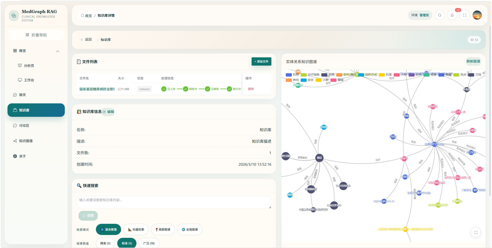

### 智能问答与参考来源

选择知识库、检索模式和重排开关后发起问答，流式查看回答，并通过参考来源进入原文与关系路径展示。

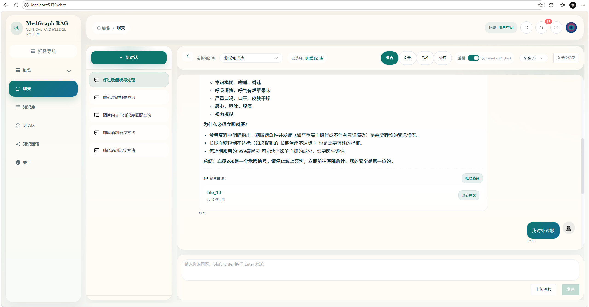

### 关系路径与图谱证据

问答关联的实体与关系在图谱中高亮展示，用于观察疾病、症状、治疗方式等资料之间的联系，并辅助核对检索证据。

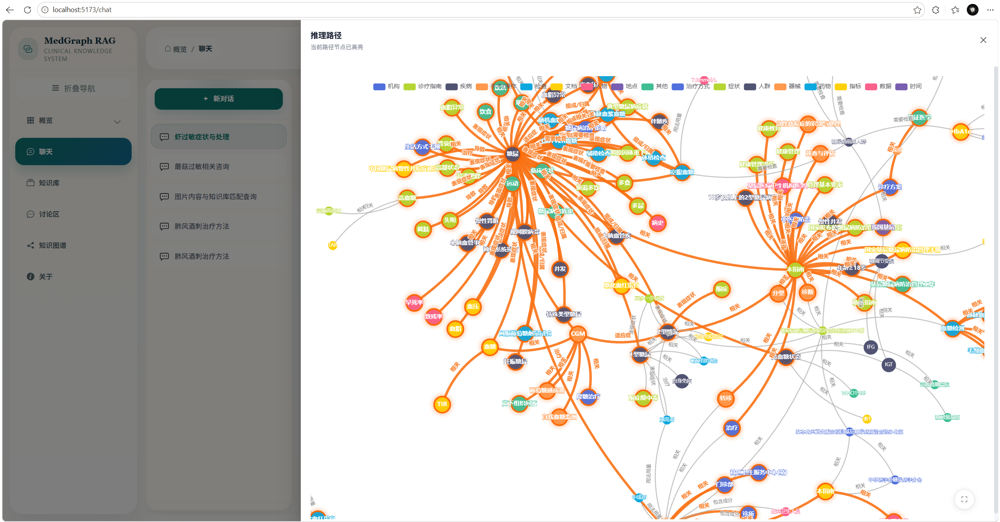

界面中的“推理路径”指关联图谱证据的可视化，不代表模型内部思维过程或经过验证的临床推理链。

### 引用原文定位

从回答的参考来源打开文档，查看高亮片段，对照原始资料判断回答是否有据可依。

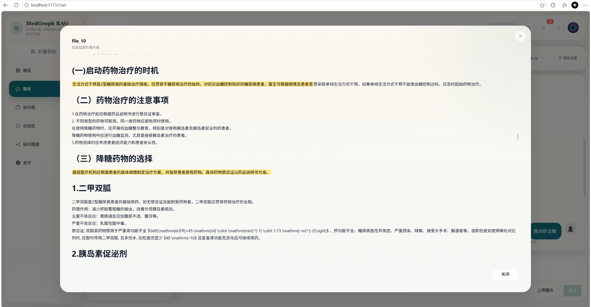

### 个人病状信息与长期档案

**档案概览：** 按过敏史、疾病、症状、既往史、体质和用药等类别查看长期记录概况，为个性化问答提供结构化背景。

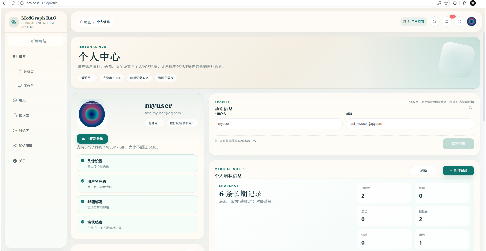

**记录明细：** 展示具体医疗事实、手动录入或对话导入等来源及更新时间，支持用户编辑和删除记录。问答前按当前用户聚合这些记录，而不是将完整档案无差别共享给其他用户。

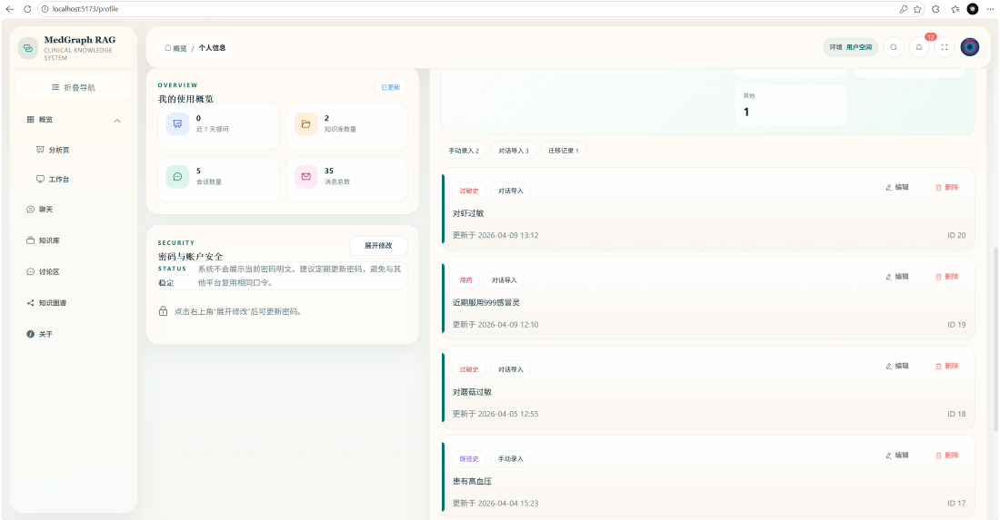

### 医疗讨论区

提供独立于知识库的全站交流入口，支持分类筛选、帖子、评论与点赞，并配套管理员治理。

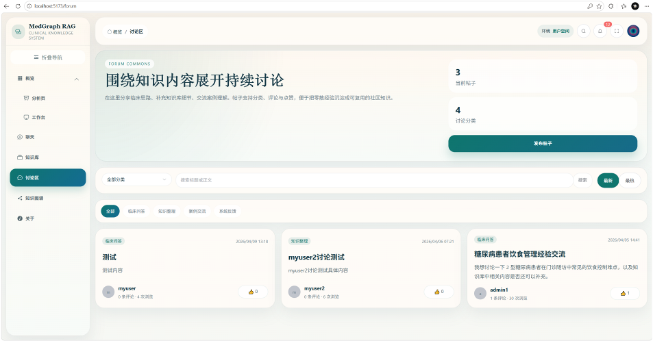

以上为项目早期演示截图，界面与当前版本可能存在差异；图片中的账号、联系方式和医疗记录在对外发布前应确认属于演示数据或已获公开授权。

## 核心能力

| 能力 | 实现要点 |
| --- | --- |
| **条件式 Agent 工作流** | 使用 LangGraph 编排用户画像加载、意图判断、问题澄清、查询改写、检索、生成与对话摘要；支持闲聊、澄清追问和知识库问答分支 |
| **向量与图谱混合检索** | 实现 `naive / local / global / hybrid` 四种模式；结合图谱扩展、来源 chunk 回填、候选去重与可选 Rerank |
| **可追溯的回答依据** | 文本块、实体、关系保留来源关联；问答返回 `references` 和 `graph_path`，前端支持原文查看与图谱展示 |
| **分层会话记忆** | 会话状态持久化与旧消息摘要配合；长期医疗事实以结构化记录保存，按用户加载为提示词摘要 |
| **图片辅助问答** | 图片写入 MinIO，经视觉理解构造 `effective_query`；原始用户文本与结构化附件独立保留 |
| **完整应用链路** | 文档上传、解析、索引与失败重试；SSE 流式问答、知识库资源权限、用户与管理员界面、审计及统计 |

项目定位是**基于状态图编排的 RAG Agent 应用**，不是多 Agent 协作平台，也不包含开放式自主规划或任意工具执行。

## 系统架构

### 总体设计架构

整体分为前端展示层、后端服务层、模型与编排层、数据与索引层，覆盖知识库、问答、医疗画像、权限审计及讨论区等模块。

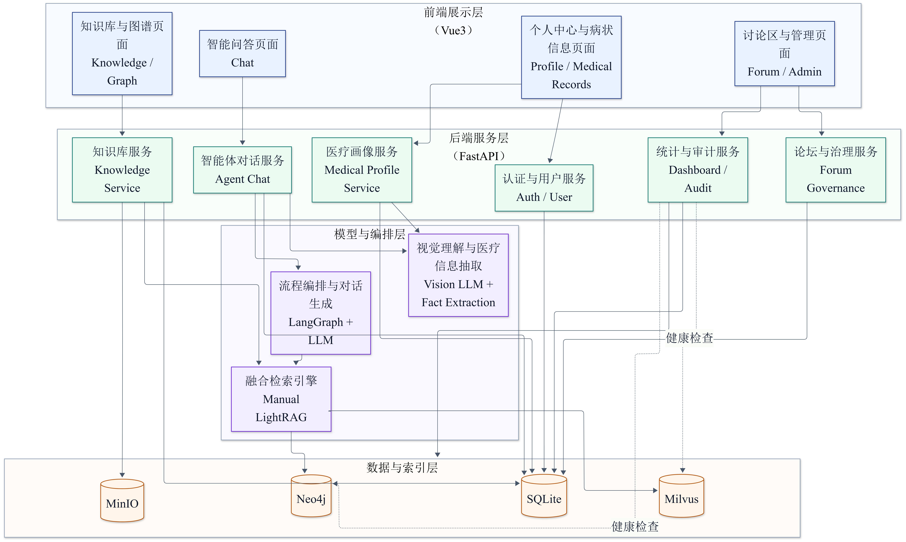

总体架构图沿用项目早期设计材料；下方简化图突出当前问答与入库主链路，具体调用关系以代码为准。

<details>
<summary>展开查看：当前问答与入库主链路简图</summary>

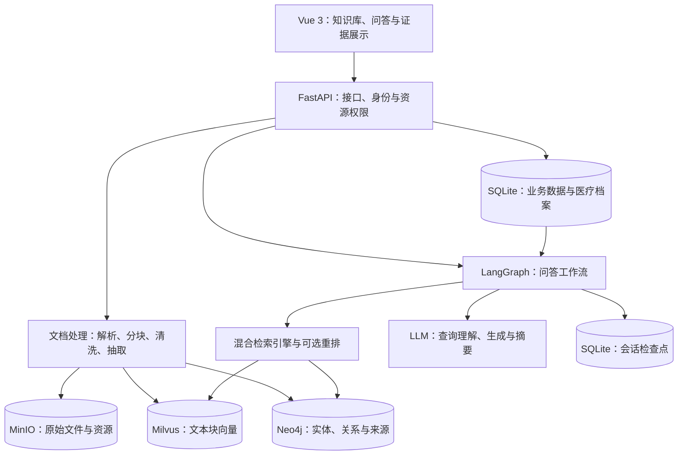

</details>

### 部署拓扑

浏览器访问 Vue 前端，FastAPI 对接 Agent、文档解析、图片理解及存储；生成、视觉与重排通过模型服务接口调用。图中表示逻辑依赖，不代表这些应用模块已全部由 Docker Compose 托管。

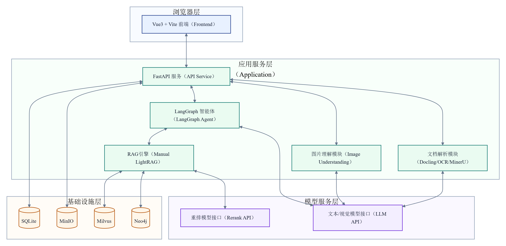

### 文档入库

原始文件写入 MinIO，经 Docling / OCR / MinerU 等处理路径转换为 Markdown，再进行分块、清洗、向量化与实体关系抽取，写入 Milvus 和 Neo4j。

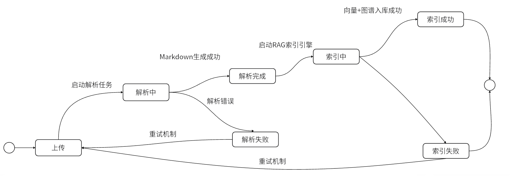

对应后端状态值：

```text
uploaded → parsing → parsed → indexing → indexed
              ↓                   ↓
        error_parsing       error_indexing
```

文件状态用于展示处理进度和触发失败重试；向量与图谱按知识库隔离，实体和关系保留来源 chunk 关联。该链路涉及多个独立存储，不等同于跨存储原子事务。

<details>
<summary>展开查看：向量化入库与知识图谱入库详细设计</summary>

**向量化入库：** 从 Markdown 分块、清洗和元数据组装，到 Embedding 与 Milvus 写入。

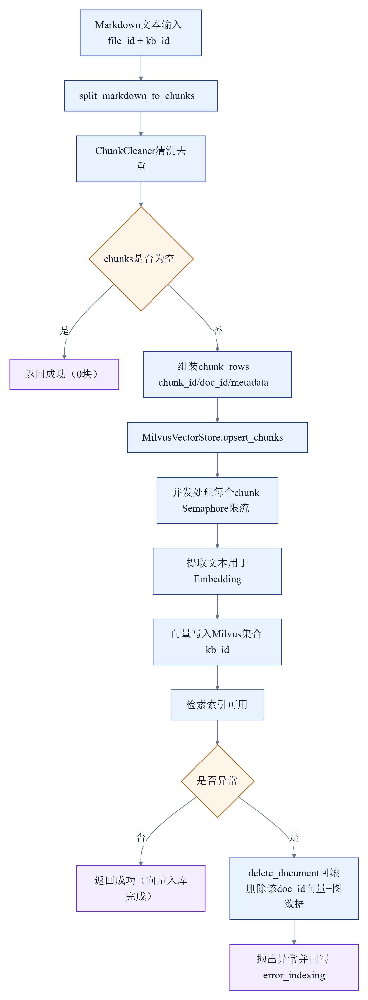

**知识图谱入库：** 实体抽取、规范化与去重，关系抽取与类型校验，并保留来源关联后写入 Neo4j。

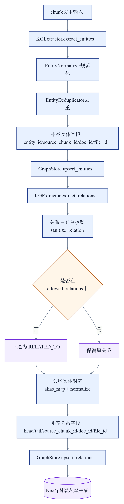

两图为早期流程设计材料，具体执行顺序、并发方式与失败清理行为以 [当前入库实现](utils/rag_utils/lightrag_engine.py) 为准；图中的“回滚”表示补偿清理，不代表跨存储事务回滚。

</details>

## Agent 工作流

下图对应当前 [LangGraph 工作流定义](agents/simple_chatbot/rag_agent.py)：

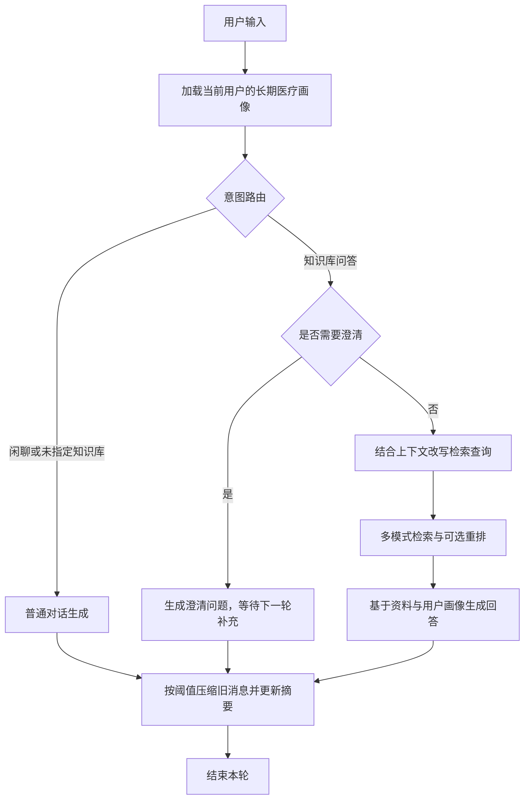

- **先判断是否需要检索：** 未指定知识库时走普通对话；知识库问答在检索前经过澄清和改写，避免将缺少上下文的问题直接送入召回。
- **区分短期与长期记忆：** 会话状态通过 LangGraph Checkpointer 保存；旧消息超过阈值后压缩为摘要。长期档案从用户发言中后台抽取，按分类与内容去重，不将模型回答作为用户事实来源。
- **保留输入与处理结果：** 用户原文、图片附件和用于检索的查询分别保留，避免把改写或视觉理解结果冒充用户原始输入。
- **流式返回答案与证据：** 正常 SSE 序列为 `start → token（多次）→ metadata → done`，异常返回 `error`；元数据携带引用及图谱信息。

## 检索设计与技术取舍

<details>
<summary>展开查看：四种检索模式与回答生成流程图</summary>

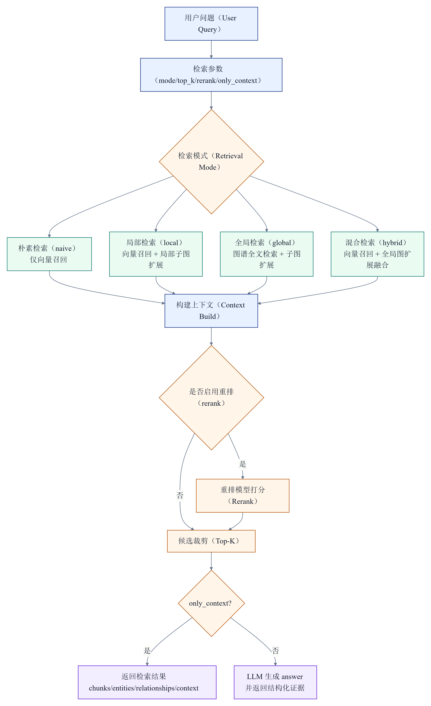

该图用于概览检索分支，沿用早期设计材料；当前候选回填、重排与裁剪顺序以实现及下表说明为准，尤其要区分图谱上下文与可重排的原文 chunk。

</details>

检索逻辑集中在 [LightRAGEngine](utils/rag_utils/lightrag_engine.py)。当前仓库自行组织了分块、抽取、存储与多模式检索代码；类名不表示直接调用官方 LightRAG 查询接口，也不表示完整复现其算法。实现细节见 [向量与图谱检索说明](docs/manual_lightrag_implementation.md)。

| 模式 | 当前实现 | 需要关注的取舍 |
| --- | --- | --- |
| `naive` | 纯向量召回文本块 | 适合作为基础对照，但依赖文本相似度与分块质量 |
| `local` | 向量召回后关联实体与关系，扩展一跳局部子图，并回填相关文本块 | 能补充邻域证据，也可能引入不相关的邻接内容 |
| `global` | Neo4j 实体全文检索与两跳子图扩展，不执行向量召回 | 依赖实体命名、抽取质量与全文匹配；当前分支未回填原文 chunk |
| `hybrid` | 融合向量命中、关联图谱及全文检索扩展结果，回填来源文本块 | 覆盖更多证据，但增加候选噪声和处理开销，不保证优于单路检索 |

**候选池与最终结果分开控制。** 先召回多于最终 `top_k` 的候选，再进行去重、可选重排与裁剪，避免过早截断。当前文本块融合采用按优先级合并、按 `chunk_id` 去重，而非学习式融合或 RRF。

**图谱证据需要能回到文本。** 实体与关系记录来源 chunk，`local / hybrid` 将相关文本回填到候选池，再与向量结果组合，供生成与引用展示使用。

**重排有收益，也有成本。** Rerank 可配置启用，默认行为由模式与环境变量共同决定；配置缺失、请求失败或没有可用结果时保留原候选，不应将这种回退视为成功执行了重排。

配套工程能力包括用户 / 管理员角色、知识库归属与文件权限继承、会话及医疗档案归属检查、写操作审计，以及独立于知识库的全站讨论区。

## 历史评测与效果分析

以下数字摘录自项目早期评测图表，用于记录当时的检索对照结果，**不是当前提交重新运行的基准测试，也不是回答准确率或医疗诊断准确率**。

| 模式 | 原图标注的命中率 @k | 原图标注的平均时延（ms） |
| --- | ---: | ---: |
| `naive` | 24.44% | 171.38 |
| `local` | 11.11% | 245.72 |
| `global` | 41.11% | 51.56 |
| `hybrid` | 24.44% | 245.79 |
| `hybrid + rerank` | 57.78% | 1123.40 |

<details>
<summary>展开查看历史评测原图</summary>

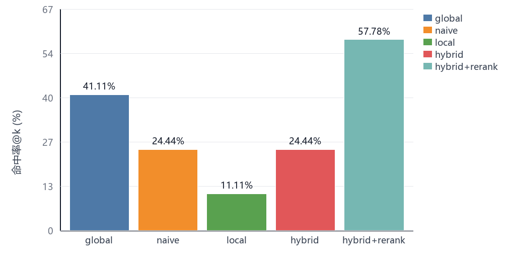

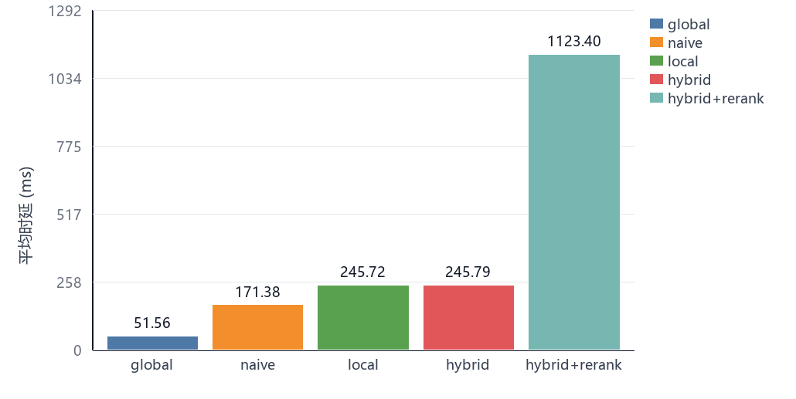

</details>

**可以观察到的现象：** 该次实验中，`hybrid + rerank` 的命中率最高，但时延也最高；未重排的 `hybrid` 没有优于 `naive`。这提示应一起评估证据覆盖、候选噪声与重排成本，而不是默认认为图谱融合一定提升效果。

**评测边界：** 当前仓库尚未提供对应数据集、标注、评测脚本与原始逐题结果；仅凭图表无法确认样本规模、`k` 值、命中定义、模型配置、计时范围及缓存条件。因此这些数据不能作为当前版本的可复现性能承诺，也不能将表中时延解释为完整问答耗时。后续需补齐统一评测材料，再验证检索与生成效果。

## 技术栈

| 层级 | 技术与用途 |
| --- | --- |
| Agent 与模型 | LangGraph、LangChain 模型接口；状态编排、模型调用、检查点与会话记忆 |
| 后端 | FastAPI、SQLAlchemy、SQLite；异步接口与业务数据存储 |
| 检索 | Milvus、Neo4j、Embedding、Rerank；向量召回、图谱扩展与候选排序 |
| 文件与解析 | MinIO、Docling、DeepSeek OCR、MinerU；原始资料、资源存储与文档转换 |
| 前端 | Vue 3、Vite、Element Plus、Pinia、G6；业务界面、流式交互与图谱展示 |

## 本地运行

> 当前仓库未提供统一的后端依赖清单和 `.env.example`，暂不具备开箱即用的复现流程。以下是现有启动入口，不是经过全新环境验证的一键部署指南。

### 环境与配置

- 准备 Python 环境并安装代码引用的后端依赖；后端依赖版本仍待整理与验证。
- 前端要求 Node.js `^20.19.0 || >=22.12.0`，以 [package.json](vue-project/package.json) 为准。
- 准备 Docker Compose，用于启动 MinIO、Neo4j、Milvus 及相关存储依赖；当前 Compose 不包含前后端应用。
- 在根目录创建本地 `.env`，填写与实际服务一致的配置，不要提交真实凭据。

| 配置范围 | 主要变量 / 注意事项 |
| --- | --- |
| 生成模型 | `LLM_API_KEY`、`LLM_BASE_URL`、`LLM_MODEL_ID` |
| 向量与 Embedding | `MILVUS_URI`、`MILVUS_TOKEN`、`MILVUS_DB_NAME`、`EMBEDDING_MODEL`、`EMBEDDING_DIM`；当前向量客户端复用 `LLM_API_KEY / LLM_BASE_URL`，服务需支持配置的 Embedding 模型 |
| 图数据库 | `NEO4J_URI`、`NEO4J_USERNAME`、`NEO4J_PASSWORD` |
| 对象存储 | `MINIO_ENDPOINT`、`MINIO_ACCESS_KEY`、`MINIO_SECRET_KEY`、`MINIO_SECURE` |
| 可选重排 | `RERANK_BASE_URL`、`RERANK_MODEL`、`RERANK_API_KEY`、`RERANK_BY_DEFAULT`、`MIN_RERANK_SCORE` |
| 解析与图片输入 | 按所选处理路径配置 `OCR_*`、`MINERU_*`、`CHAT_IMAGE_*`；详见 [配置与开发约定](AGENTS.md) |

存储连接地址、端口和认证信息需与 [docker-compose.yml](docker-compose.yml) 一致。更换 Embedding 模型或维度后，应评估重新建索引与向量化，避免混用不同语义空间。

### 启动服务

在仓库根目录启动存储依赖：

```powershell
docker compose up -d
```

完成后端依赖安装与 `.env` 配置后，在根目录启动后端：

```powershell
python main.py
```

后端默认地址：`http://127.0.0.1:8000`；FastAPI 接口文档：`http://127.0.0.1:8000/docs`。

另开终端启动前端：

```powershell
cd vue-project
npm install
npm run dev
```

前端开发地址通常为 `http://localhost:5173`，以 Vite 输出为准。默认请求 `http://127.0.0.1:8000/api`；修改后端地址时配置前端 `VITE_API_BASE`，跨域访问还需同步检查后端允许的来源。

前端生产构建：

```powershell
cd vue-project
npm run build
```

### 建议验证路径

1. 登录后创建知识库，上传有使用授权的示例文档，确认文件状态到达 `indexed`。
2. 选择知识库提问，检查流式回答、参考来源、原文定位与图谱展示。
3. 切换检索模式和重排开关，对照同一组问题的证据差异；确认重排服务实际可用。
4. 使用上下文指代或信息不完整的问题，检查改写 / 澄清行为，并验证多轮会话与用户画像加载。

后端启动时会自动建表、补齐旧 SQLite 字段、迁移旧医疗画像并初始化论坛分类。数据库、`saves/` 及各存储数据目录属于运行数据；不要为演示直接清空已有数据，也不要将真实医疗档案提交到仓库。

## 代码导览

| 入口 | 重点内容 |
| --- | --- |
| [Agent 工作流](agents/simple_chatbot/rag_agent.py) | 状态字段、条件路由、澄清改写、生成与记忆摘要 |
| [Agent 基类](agents/common/base.py) | 检查点、会话状态持久化与流式执行 |
| [混合检索引擎](utils/rag_utils/lightrag_engine.py) | 文档入库、多模式召回、图块回填、去重与重排 |
| [查询理解](utils/rag_utils/) | 查询改写、澄清、分块、清洗与实体关系抽取 |
| [问答接口](routers/agent.py) | SSE、会话历史、图片输入与后台长期事实抽取 |
| [知识库接口](routers/knowledge.py) | 文件处理、失败重试、资源访问、检索与图谱 |
| [权限校验](utils/auth_midware.py) | 身份、角色与资源访问控制 |
| [医疗档案处理](utils/medical_profile_utils.py) | 结构化事实归一化、去重与摘要聚合 |
| [前端 API](vue-project/src/api/index.js) | 接口封装、Token 刷新与 SSE 事件解析 |
| [Schema 与抽取规范](docs/schema.md) | 医疗图谱类型；配套 [抽取规范](docs/extraction_guidelines.md) 与 [提示词](docs/prompts/) |
| [应用入口](main.py) | 启动期建表、兼容迁移、分类初始化与检索引擎初始化 |

## 项目边界与后续计划

项目采用 AI 辅助开发，围绕医疗知识管理场景持续迭代。当前重点是贯通 Agent 问答与证据展示链路，而非宣称达到生产级或临床应用标准。

- **可复现性：** 补齐后端依赖清单、配置模板、最小公开示例文档与全新环境启动验证。
- **效果评估：** 建立固定问答集、来源标注和评测脚本，区分检索命中、回答依据与端到端时延，并纳入失败样例。
- **回归验证：** 当前没有统一后端 pytest 体系；后续补充查询理解、权限隔离、SSE 与索引生命周期回归。
- **可靠性与隐私：** 继续完善跨存储失败恢复、异常可观测性、日志脱敏及医疗数据保护；已有权限与审计不等同于完成安全或合规认证。
